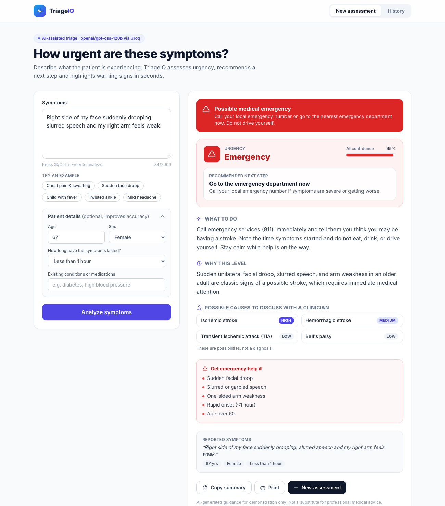
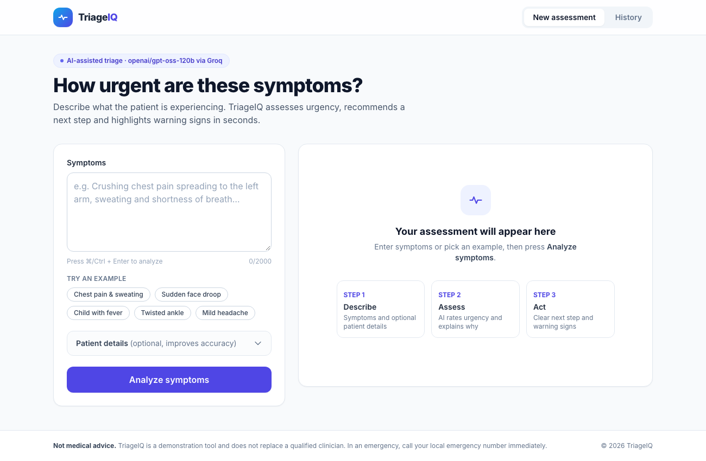
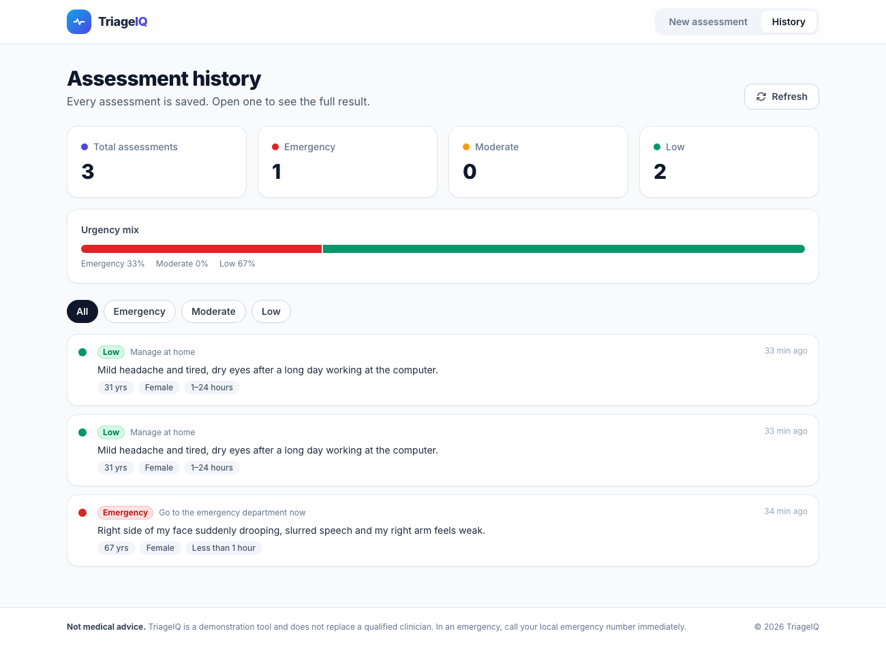

# TriageIQ: AI Medical Triage Assistant

TriageIQ is a Laravel web app and REST API that rates how urgent a patient's symptoms are. You describe the symptoms, optionally add the patient's age, sex, how long the symptoms have lasted and any existing conditions, and an AI model returns a structured triage report: an urgency level, a recommended next step, possible causes, warning signs that need emergency care, and self-care tips.

> **Not medical advice.** TriageIQ is a demonstration and research prototype. It assesses urgency; it does not diagnose, and it does not replace a qualified clinician. In an emergency, call your local emergency number.

**[Watch the 75-second demo on YouTube](https://www.youtube.com/watch?v=CBgPx7iSCyI)**

[](https://www.youtube.com/watch?v=CBgPx7iSCyI)

## Features

- **Urgency rating.** Every assessment is rated `low`, `medium` or `emergency`, with the AI's confidence as a percentage.
- **Recommended next step.** One of: manage at home, see a doctor within a few days, be seen within 24 hours, or go to the emergency department now.
- **Full triage report.** What to do, why this urgency level was chosen, up to four possible causes with their likelihood, red-flag symptoms, and self-care tips.
- **Patient context.** Optional age, sex, symptom duration and existing conditions are passed to the model to improve the assessment.
- **Assessment history.** Every assessment is saved to the database. The History tab shows totals by urgency and lets you reopen any past report.
- **Demo-friendly UI.** One-click example cases, a clear emergency banner, and copy and print buttons for each report.
- **REST API.** The same assessment is available as JSON for other systems to use.
- **Safety checks.** The model's response is validated on the server: unknown values become `unknown`, any emergency always gets the "go to the emergency department" step, and AI output is escaped before it is displayed.

## Screenshots

| New assessment | History |
|---|---|
|  |  |

## Tech stack

| Layer | Technology |
|---|---|
| Backend | Laravel 12, PHP 8.2+ |
| Database | MySQL or MariaDB |
| AI | [Groq](https://groq.com) API running `openai/gpt-oss-120b` (configurable), called through [`openai-php/client`](https://github.com/openai-php/client) |
| Frontend | Blade template, Tailwind CSS (CDN), plain JavaScript |

No JavaScript build step is needed: the page loads Tailwind and the Inter font from a CDN, so the browser needs an internet connection.

## Getting started

### Requirements

- PHP 8.2 or later and [Composer](https://getcomposer.org)
- MySQL or MariaDB (XAMPP, Homebrew or DBngin all work)
- A free Groq API key from [console.groq.com](https://console.groq.com)

### Installation

```bash
# 1. Clone the repository
git clone https://github.com/henryhkb/ai-medical-triage.git
cd ai-medical-triage

# 2. Install PHP dependencies
composer install

# 3. Create your environment file and app key
cp .env.example .env
php artisan key:generate
```

### Configuration

Create an empty database (for example `medical_triage_api`) in phpMyAdmin or from the command line:

```bash
mysql -u root -p -e "CREATE DATABASE medical_triage_api"
```

Then set these values in `.env`:

```dotenv
DB_CONNECTION=mysql
DB_HOST=127.0.0.1
DB_PORT=3306
DB_DATABASE=medical_triage_api
DB_USERNAME=root
DB_PASSWORD=

GROQ_API_KEY=your_groq_api_key
GROQ_MODEL=openai/gpt-oss-120b
```

| Variable | Required | Description |
|---|---|---|
| `GROQ_API_KEY` | Yes | Your Groq API key. Keep it out of version control; `.env` is already git-ignored. |
| `GROQ_MODEL` | No | Any chat model your Groq key can use. Defaults to `openai/gpt-oss-120b`. |
| `DB_*` | Yes | Your database connection. |

### Run

```bash
php artisan migrate
php artisan serve
```

Open **http://localhost:8000**. Pick one of the example cases and click **Analyze symptoms** to see a report.

## API

### `POST /api/triage`

Assesses symptoms and saves the result. Rate limited to 20 requests per minute per client.

**Request**

| Field | Type | Required | Notes |
|---|---|---|---|
| `symptoms` | string | Yes | Up to 2,000 characters |
| `age` | integer | No | 0 to 120 |
| `sex` | string | No | `female`, `male` or `other` |
| `duration` | string | No | For example `Less than 1 hour` or `1–3 days`. Up to 50 characters. |
| `conditions` | string | No | Existing conditions or medications. Up to 500 characters. |

```bash
curl -X POST http://localhost:8000/api/triage \
  -H "Content-Type: application/json" \
  -H "Accept: application/json" \
  -d '{
        "symptoms": "Right side of my face suddenly drooping, slurred speech and my right arm feels weak.",
        "age": 67,
        "sex": "female",
        "duration": "Less than 1 hour"
      }'
```

**Response** `200 OK`

```json
{
  "record": {
    "id": 3,
    "symptoms": "Right side of my face suddenly drooping, slurred speech and my right arm feels weak.",
    "patient": { "age": 67, "sex": "female", "duration": "Less than 1 hour" },
    "created_at": "2026-11-21T19:41:09+00:00",
    "ai": { "...": "same object as below" }
  },
  "ai": {
    "severity": "emergency",
    "next_step": "emergency",
    "advice": "Call emergency services immediately and tell them you think you may be having a stroke...",
    "reason": "Sudden unilateral facial droop, slurred speech, and arm weakness in an older adult are classic signs of a possible stroke...",
    "possible_conditions": [
      { "name": "Ischemic stroke", "likelihood": "high" },
      { "name": "Hemorrhagic stroke", "likelihood": "medium" },
      { "name": "Transient ischemic attack (TIA)", "likelihood": "low" }
    ],
    "red_flags": ["Sudden facial droop", "Slurred or garbled speech", "One-sided arm weakness"],
    "self_care": [],
    "confidence": 95
  }
}
```

**Response fields (`ai`)**

| Field | Values |
|---|---|
| `severity` | `low`, `medium`, `emergency`, or `unknown` if the model's answer could not be used |
| `next_step` | `self_care`, `see_doctor`, `urgent_care` or `emergency` |
| `advice`, `reason` | Plain-language text, 1 to 3 sentences each |
| `possible_conditions` | Up to 4 items, each with `name` and `likelihood` (`high`, `medium` or `low`) |
| `red_flags`, `self_care` | Up to 5 short strings each. `self_care` is always empty for emergencies. |
| `confidence` | Integer from 0 to 100, or `null` |

**Errors**

| Status | When |
|---|---|
| `422` | Validation failed, for example missing `symptoms` or an age above 120 |
| `429` | More than 20 requests in a minute |
| `500` | `GROQ_API_KEY` is not set |
| `502` | The Groq API could not be reached or rejected the request |

### `GET /api/triage/history`

Returns totals by urgency and the 50 most recent assessments, newest first. Each record has the same shape as `record` above.

```json
{
  "stats": { "total": 3, "emergency": 1, "medium": 0, "low": 2 },
  "records": [ { "id": 5, "symptoms": "...", "patient": {}, "created_at": "...", "ai": { } } ]
}
```

## How it works

1. The user submits symptoms from the web page, or a client calls `POST /api/triage`.
2. `TriageController` validates the input and sends it to Groq with a system prompt that asks for a single JSON object with fixed fields. When unsure between two urgency levels, the model is told to choose the more urgent one.
3. The response is parsed and normalized: invalid values are replaced with safe defaults and lists are trimmed.
4. The assessment is saved to the `triage_records` table, including the raw model output for auditing.
5. The page renders the report and adds it to History.

## Project structure

```
app/
├── Http/Controllers/TriageController.php   # Validation, Groq call, normalization, history
└── Models/TriageRecord.php                 # Eloquent model (patient and details stored as JSON)
config/services.php                         # Groq key, model and base URL
database/migrations/
├── 2025_11_26_215628_create_triage_records_table.php
└── 2026_11_21_000000_add_patient_and_details_to_triage_records_table.php
resources/views/triage.blade.php            # The TriageIQ page (Tailwind + plain JS)
routes/
├── api.php                                 # POST /api/triage, GET /api/triage/history
└── web.php                                 # / and /triage-ui
docs/screenshots/                           # Images used in this README
```

## Limitations

- **Not a medical device.** Results come from a general-purpose language model and can be wrong. Always defer to a clinician.
- **No authentication.** Anyone who can reach the app can run assessments and read the history. Add authentication before deploying anywhere public or storing real patient data, and follow the health-data rules that apply where you operate.
- **Needs internet.** Both the AI model and the page's styles are loaded over the network.

## Contributing

Pull requests are welcome. For larger changes, please open an issue first to discuss what you would like to change.

## License

MIT. See [LICENSE](LICENSE).
